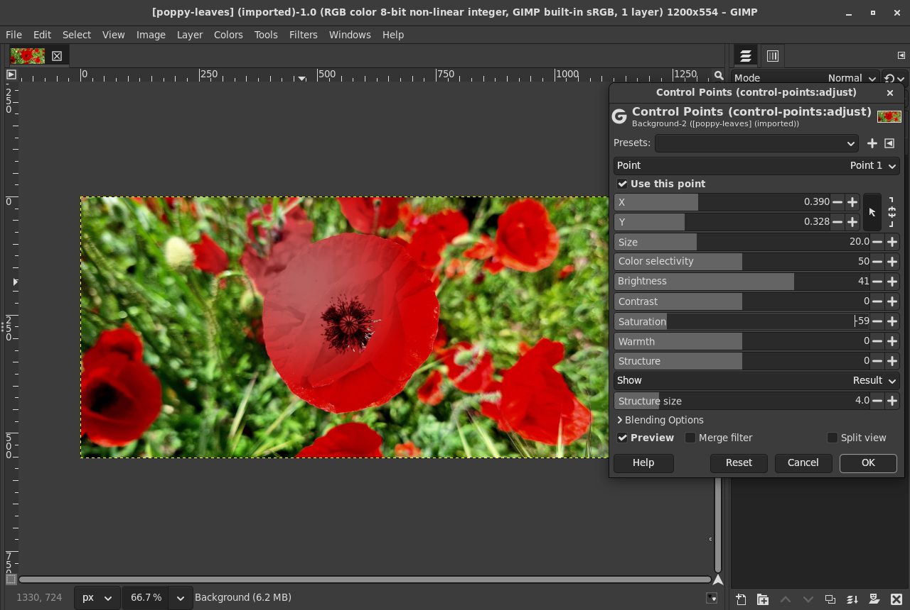
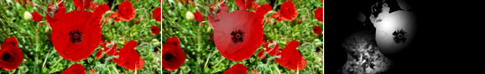
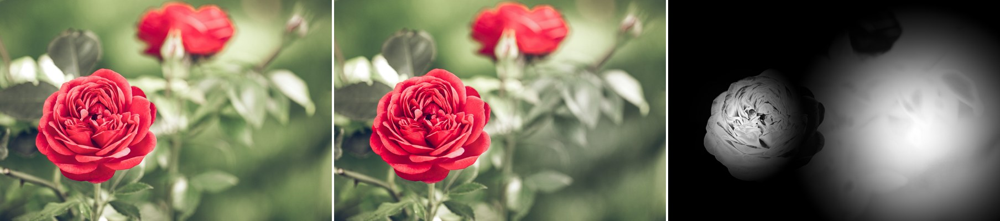

# gegl-control-points

Control points for GIMP 3 in the style of Nik's U Point (Viveza, Color
Efex): place up to eight points on the image, and each point changes
brightness, contrast, saturation, warmth and structure of the pixels near
it **that look like the pixel under it**. A point on a red flower
brightens the flower and leaves the green leaves around it alone, without
a mask or a selection.

It is one GEGL operation, `control-points:adjust`, so in GIMP 3.2 it is a
non-destructive filter (**Colors > Control Points...**): it stays editable
on the layer, is saved in the XCF, and can be stacked with other filters.
The points are placed with GIMP's own **Pick coordinates from the image**
button in the filter dialog.

| Photo, result, mask of all points | |
|---|---|
|  | Point 1 on the big poppy (brightness +40, saturation -60), point 2 on the leaves at the bottom left (warmth +70); selectivity 50 for both. The leaves next to the poppy and the other poppies do not change. |
|  | Point 1 on the rose (saturation +40, structure +60, brightness -15), point 2 on the background (brightness -40, saturation -50, size 40, selectivity 30). |

The photos are CC0 (tests/images/README.md).

## In GIMP

**Colors > Control Points...** opens the dialog
([screenshot](docs/dialog.png)):

- **Point** chooses which of the eight points the dialog shows. Only the
  chosen point's settings are shown, so the dialog stays short; every
  point that is on acts, whichever is shown.
- **Use this point** turns the point on (point 1 is on at the start, the
  others off; the settings of a point that is off are greyed out).
- **X** and **Y**, with the arrow button next to them: click the button,
  then click on the image, and the point is where you clicked. The
  numbers are relative to the layer (0 to 1), so a preset or a copied
  filter fits images of any size.
- **Size**: how far the point reaches, in percent of the longer side of
  the image. Its influence falls smoothly to nothing at that distance.
- **Color selectivity**: 0 acts on everything in reach, 50 (the default)
  on colors like the one under the point, 100 only on nearly the same
  color.
- **Brightness**, **Contrast**, **Saturation**, **Warmth**, **Structure**
  (-100 to 100): what the point does.
- **Show**: the result, the mask of the chosen point, or the mask of all
  points (white: fully changed, black: not at all), to set size and
  selectivity like Nik's "show mask"
  ([mask of a point](docs/mask-of-point.png),
  [mask of both points](docs/mask-of-all.png)).
- **Structure size**: the size of the detail that Structure changes, for
  all points.

A point with no adjustments still counts: where it is the stronger
point, it holds other points back, like a neutral point in Nik (it
protects that area; tests: a neutral point 60 pixels from a brightness
+70 point lowers the change at its center from 8.5 to 5.1 L*). More than
eight points: add the filter a second time; GIMP's filter stack applies
one after the other.

GIMP 3.2 builds the dialog from the operation's properties
(`app/propgui/gimppropgui-generic.c` at tag `GIMP_3_2_6`): a property with
`axis` = `x` directly followed by one with `axis` = `y`, both with `unit`
= `relative-coordinate` (or `pixel-coordinate`), gets the chain button and
the "Pick coordinates from the image" button (lines 93 to 195). GIMP puts
the click into the pair in `app/tools/gimpoperationtool.c`
(`gimp_operation_tool_color_picked`): it subtracts the layer's offset and
the filter area's origin and, for relative coordinates, divides by the
area's width and height. The rows of the chosen point come from the
`visible` key (`point {p3}`) and the greying from the `sensitive` key
(`p3-enabled`), which GIMP evaluates in `app/propgui/gimppropgui-eval.c`
and updates as the settings change (`gimppropgui.c`, lines 410 to 437).

### Why eight points

A GEGL operation has a fixed set of properties, so the number of points
is fixed. Each point is ten properties; eight points make 83 properties,
which GIMP builds (hidden) widgets for and saves in every XCF that uses
the filter. Eight is a judgement: enough for a few objects with a point
or two each and a neutral point, a short "Point" list, and a bounded time
per pixel (each point in reach costs a color distance; eight large
points take 0.42 s on 24 megapixels, below). A second instance of the
filter gives eight more.

## On the command line

    gegl photo.jpg -o out.png -- control-points:adjust \
      p1-x=0.39 p1-y=0.33 p1-brightness=40 p1-saturation=-60 \
      p2-enabled=true p2-x=0.25 p2-y=0.82 p2-warmth=70

Properties: `point` (`p1` to `p8`), `view` (`result`, `mask`, `all`),
`structure-size`, and for each point n: `pn-enabled`, `pn-x`, `pn-y`,
`pn-size`, `pn-selectivity`, `pn-brightness`, `pn-contrast`,
`pn-saturation`, `pn-warmth`, `pn-structure`.

## Method

The idea is Nik's U Point, as published in its patents (US 6,728,421 and
its family, all expired: docs/patents.md) and in Binder, Steiding, Wille
and Kokemohr, "Design of user interfaces for selective editing of digital
photos on touchscreen devices", Proc. SPIE 8667, 86671N (2013),
doi:10.1117/12.2003147: a pixel close to a point in space **and** similar
to it in brightness and color gets a high weight, a far or different
pixel a low one, and the points' parameters are mixed per pixel by their
weights, with an imaginary far point that stands for "no change". The
formulas here are this operation's own.

**The color under a point** is the mean of the finite pixels of the 5 x 5
square at the point, in linear RGB, converted to CIE Lab (D50, from
babl's RGB to XYZ matrix of the image's space, so a color gives the same
Lab in any RGB space). The operation asks GEGL for those pixels in
`get_required_for_output`, whatever region is being rendered, so the
result does not depend on tiles, threads or the region: the color is the
same for every tile. A change of the input under a point invalidates
everything the point reaches (`get_invalidated_by_change`).

**The weight** of point i at pixel p, with d the distance from p's center
to the point, R the point's reach (size x the longer side / 100), and
dE the distance in Lab to the point's color with lightness counted 0.4
(the parts of one object differ more in light and shade than in hue):

    w_i = (1 - (d/R)^2)^2 * exp(-dE^2 / (2 tau^2))    for d < R, else 0
    dE^2 = (0.4 dL)^2 + da^2 + db^2
    tau  = 25 * 50 / selectivity    (no color term at selectivity 0)

The spatial part is smooth (its slope is zero at R) and exactly zero
beyond R, so the circle is the reach and pixels outside every circle are
passed through bit for bit. At selectivity 50 a color 25 away (in these
units) keeps 61 % of the weight, one 50 away 14 %, and green leaves
against a red flower (about 100 away) nothing measurable.

**Mixing the points.** The points' share of the change at p is their
union, and it is divided among them by their weights:

    alpha = 1 - prod_i (1 - w_i)
    beta_i = w_i * alpha / sum_j w_j
    parameter(p) = sum_i beta_i * parameter_i

This is the normalized form of the paper's equation (2),
`sum w_i gamma_i / (w_0 + sum w_i)`, with the "no change" weight
`w_0 = sum w_j (1 - alpha) / alpha` chosen per pixel so that **a point
alone acts with exactly its own weight** (beta = w), two points with the
same settings never add up to more than one, and overlapping points with
different settings blend smoothly. The masks are beta_i (one point) and
alpha (all points), shown as lightness.

**The adjustments**, applied once per pixel with the mixed parameters
(each -1 to 1), in linear RGB of the image's space, with the luminance Y
from babl and lightness L = CIE L* / 100:

- warmth t: red times 1 + 0.3 t, blue times 1 - 0.3 t, then the
  luminance put back;
- saturation s: the channels moved away from (or towards) Y by 1 + s;
  more saturation only as far as the color stays within 0 and the
  brightest of 1 and the pixel's own channels;
- brightness b: L to L^(2^(-0.75 b)) (a gamma on lightness: black and
  white stay, above 1 it continues with the slope at 1);
- contrast c: L + a * 2 (2L - 1) L (1 - L) with a = 0.45 c (c > 0) or
  0.6 c (c < 0): steeper or flatter at middle gray, monotonic, 0 and 1
  stay;
- structure u: L plus (1.5 u or u) times the detail, L minus its
  Gaussian blur of radius "Structure size" (3 sigma, clamped at the image
  edges), the detail soft limited to about 0.15 so that strong edges get
  no halos;
- the new lightness is applied by scaling the pixel's RGB by Y'/Y, so the
  chromaticity stays.

Alpha is passed through. Pixels that are not finite (NaN, infinity) are
passed through unchanged, are left out of the colors under the points and
count as 0 in the structure blur, so they spread nowhere. Values above 1
(high dynamic range) and below 0 are handled without clipping. All
precisions of GIMP work (the operation computes in 32 bit float).

GEGL's mipmap `level` is ignored: GIMP 3.2 renders filters at level 0
(`app/gegl/gimptilehandlervalidate.c` blits at scale 1.0 and the display
downsamples the projection).

## Tests

    tests/images/fetch.py     # the CC0 photos (not in git)
    tests/check.sh            # numbers, also under ASan and UBSan
    tests/gimp-check.sh       # in headless GIMP, XCF, the command line
    tests/gui/shots.sh        # the dialog on Broadway, the screenshots
    tests/bench.sh            # 24 megapixels

Everything builds and runs inside the GIMP Flatpak's SDK
(gimp-devtools/gimp-build.sh) with a throwaway home in tests/output;
each script lists the user's folders of GIMP and other apps before and
after (tests/isolate.sh, a copy of gimp-devtools/isolate.sh) and fails if
anything changed. Results with GIMP 3.2.6 (Flatpak), GEGL 0.4.72, babl
0.1.128:

- **Selectivity**, a generated red flower crossed by green leaf stripes,
  a point on a petal, brightness +60 and saturation -60, mean change
  (CIE dE) within half the size:

  | Selectivity | Flower | Leaves at the same distances | Ratio |
  |---|---|---|---|
  | 0 | 33.1 | 27.4 | 1.2 |
  | 25 | 33.0 | 4.24 | 7.8 |
  | 50 | 32.7 | 0.012 | 2660 |
  | 75 | 32.2 | 0.000 | 10^7 |
  | 100 | 31.5 | 0 | |

  On the photos, within the point's reach: poppy-leaves.jpg red 20.5,
  green 0.01 (ratio 2205); rose-green.jpg red 12.2, green 0.01 (1282).
- **Falloff**: the mask along a radius matches (1 - (d/R)^2)^2 to
  1.4e-7; brightness +50 on L* 50 changes 8.60, 7.58, 4.94, 1.67 and 0 L*
  at 0, 1/4, 1/2, 3/4 and 1 of the size, decreasing, and nothing beyond.
- **Two points**, brightness +70 and -70, overlapping: the largest step
  between neighbouring pixels is 0.235 L* (one point alone 0.122) over a
  range of 24.9 L*: no seam. Two points with brightness +70 60 pixels
  apart: brightest 61.773 L*, one point 61.772.
- **Identity**: bit exact with the defaults, with every point off
  (adjustments set), and with every point on and all adjustments 0; an
  8 bit image with a tiny point in a corner is unchanged beyond it.
- **Tiles, threads, regions**: identical (difference 0) for tile sizes
  32 x 32 to 700 x 16, a buffer origin at 37, -21, 1, 3, 8 and 24
  threads, and regions that do not contain the pixels under the points,
  for the result and both masks.
- Each adjustment moves what it should (mean L*, its spread, chroma, b*,
  pixel texture; warmth keeps the luminance to 2e-7); alpha kept; NaN and
  infinite pixels, one under a point, kept and not spread; values up to
  40 and below 0 give finite results; nine buffer formats against float;
  the same colors in ProPhoto RGB give the same masks (3.4e-6).
- 50 checks, 48 of them also under AddressSanitizer and
  UndefinedBehaviorSanitizer with no errors and no leaks in this code.
- **In GIMP** (tests/gimp-check.sh): as a Gimp.DrawableFilter in every
  precision and in grayscale, the same as plain GEGL (to one 8 bit step),
  the settings kept through XCF, a layer with offsets, and GIMP's
  results against the gegl command line with the same settings
  (difference 0).
- **The dialog** (tests/gui/shots.sh): Colors > Control Points, point 1
  and point 2 placed by clicking the picker and the image, the masks, the
  split view, OK, and the saved XCF read back in headless GIMP: one live
  filter, the picked positions 0.390, 0.328 and 0.250, 0.818 for clicks
  at 0.39, 0.33 and 0.25, 0.82, the settings kept.

### Speed

6000 x 4000 pixels (24 megapixels), best of three, 24 threads, float
(8 bit images take the same time):

| | Time |
|---|---|
| 1 point, size 20 | 0.23 s |
| 8 points, size 20 | 0.33 s |
| 8 points, size 20, structure on 4 | 0.46 s |
| 8 points, size 60 | 0.42 s |
| 8 points, size 60, structure on 4 | 0.56 s |
| 8 points, size 60, mask view | 0.34 s |
| gegl:gaussian-blur, std-dev 40 (for scale) | 0.43 s |
| gegl:brightness-contrast (for scale) | 0.19 s |

With one thread, eight points of size 60 take 3.3 s (4.6 s with
structure). On the 24 megapixel photo rose-bush-24mp.jpg: 0.29 s for
eight points of size 20.

## Building

With the Flatpak GIMP and its SDK (see gimp-devtools):

    gimp-build.sh . meson setup build -Dmoduledir=\$GEGL_OPDIR
    gimp-build.sh . ninja -C build install

`$GEGL_OPDIR` is `~/.var/app/org.gimp.GIMP/data/gegl-0.4/plug-ins` for the
Flatpak, `~/.local/share/gegl-0.4/plug-ins` natively. With a native GIMP 3
and its development files, plain `meson setup build
-Dmoduledir=~/.local/share/gegl-0.4/plug-ins && ninja -C build install`.
Restart GIMP after installing.

## License

GPL-3.0-or-later (COPYING). The test photos are CC0 (tests/images).
